

**I turn ideas into working software, from microservices to ML pipelines.**

 &nbsp; &nbsp; &nbsp;

 &ensp;&nbsp; &ensp;&nbsp; &ensp;&nbsp; &ensp;&nbsp; &ensp;&nbsp; &ensp;&nbsp; &ensp;&nbsp; &ensp;&nbsp;

##  About

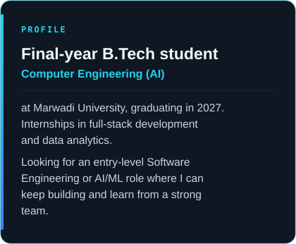
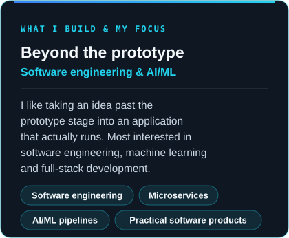

##  Projects

<table width="100%">
<tr><td>

<h3> 01 · Park IQ</h3>
<b>FULL-STACK · MICROSERVICES</b>

A microservices-based parking management platform. Authentication, parking slot management, booking, pricing and payments are split across an API gateway and dedicated services.

<b>Built with</b> 
<kbd> Node.js</kbd> <kbd> Express</kbd> <kbd> MongoDB</kbd> <kbd> React</kbd> <kbd> Vite</kbd> <kbd> Socket.IO</kbd> <kbd> Stripe</kbd> <kbd> Docker</kbd>

 &nbsp; 

</td></tr>
</table>

<table width="100%">
<tr><td>

<h3> 02 · PulseLensAI</h3>
<b>MACHINE LEARNING · DATA SIGNALS</b>

A startup risk and early failure detection platform. It combines website, hiring and social media signals in a hybrid scoring engine to estimate startup health and flag operational risk.

<b>Built with</b> 
<kbd> Python</kbd> <kbd> Flask</kbd> <kbd>Scikit-learn</kbd> <kbd> Pandas</kbd> <kbd>BeautifulSoup</kbd>

 &nbsp; 

</td></tr>
</table>

<table width="100%">
<tr><td>

<h3> 03 · AI Career Autopilot</h3>
<b>AI · FULL-STACK</b>

A resume-driven career planning assistant. It extracts skills from a resume, compares them with job-market data and generates a 12-week learning roadmap, with job tracking and an AI advisor.

<b>Built with</b> 
<kbd> Next.js</kbd> <kbd> FastAPI</kbd> <kbd> MongoDB</kbd> <kbd> Hugging Face</kbd> <kbd>Groq</kbd>

 &nbsp; 

</td></tr>
</table>

##  Skills

<table width="100%">
<tr>
<td width="50%" valign="top">

 <b>Languages</b> 
<kbd> Python</kbd> <kbd>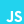 JavaScript</kbd> <kbd> TypeScript</kbd> <kbd>SQL</kbd>

</td>
<td width="50%" valign="top">

 <b>AI / ML</b> 
<kbd>Scikit-learn</kbd> <kbd> Pandas</kbd> <kbd>LSTM</kbd> <kbd>Model Evaluation</kbd> <kbd>Explainable AI (SHAP)</kbd>

</td>
</tr>
<tr>
<td width="50%" valign="top">

 <b>Frontend</b> 
<kbd> HTML</kbd> <kbd> CSS</kbd> <kbd> React</kbd> <kbd> Next.js</kbd>

</td>
<td width="50%" valign="top">

 <b>Backend</b> 
<kbd> Flask</kbd> <kbd> FastAPI</kbd> <kbd> Node.js</kbd> <kbd> Express</kbd> <kbd>REST APIs</kbd>

</td>
</tr>
<tr>
<td width="50%" valign="top">

 <b>Databases</b> 
<kbd>MySQL</kbd> <kbd> MongoDB</kbd> <kbd> Firebase</kbd>

</td>
<td width="50%" valign="top">

 <b>Tools &amp; Cloud</b> 
<kbd> Git</kbd> <kbd> GitHub</kbd> <kbd> Docker</kbd> <kbd>AWS</kbd> <kbd>VS Code</kbd>

</td>
</tr>
</table>

##  Experience

###  Professional Internships

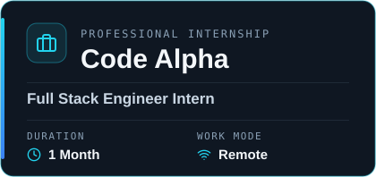
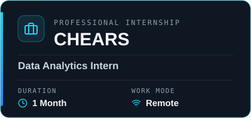

###  Virtual Internships &amp; Job Simulations

*Online job simulations completed virtually. These are not employment and not company internships.*

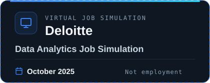
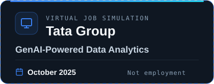
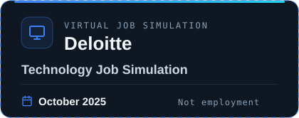
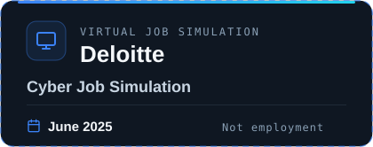

##  Certifications

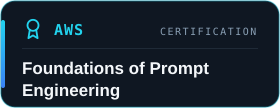
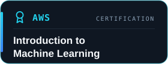
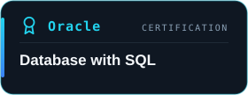 
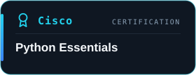
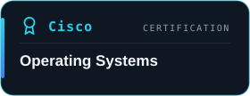

##  Learning Programs &amp; Events

###  Learning Programs

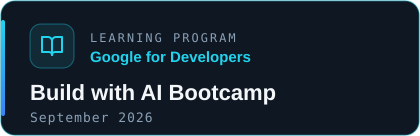
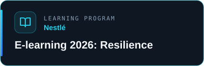

###  Hackathons &amp; Events

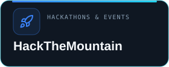
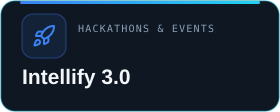
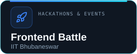

##  Patent

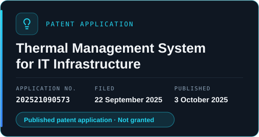

##  Education

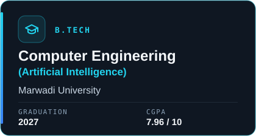
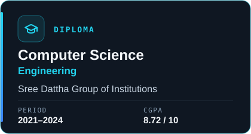

##  Contact

Open to entry-level Software Engineering and AI/ML opportunities across India.

 &nbsp;&nbsp;
 &nbsp;&nbsp;
 &nbsp;&nbsp;

