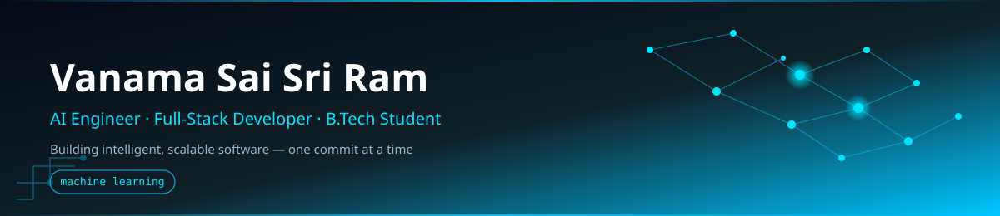

 

## About Me

I'm **Vanama Sai Sri Ram**, a final-year **B.Tech Computer Engineering (Artificial Intelligence)** student at **Marwadi University** (graduating 2027, CGPA **7.96 / 10**).

I enjoy building software, solving problems, and turning ideas into working applications. I've worked on full-stack web applications and machine learning projects using Python and modern web technologies, and through these projects and internships I've been learning how applications are built, how to work with data, and how the development process runs in practice.

I'm particularly interested in software engineering and AI/ML, and I'm looking for **entry-level Software Engineering and AI/ML opportunities** in India.

| | |
|---|---|
| **Education** | B.Tech, Computer Engineering (AI), Marwadi University |
| **Graduation** | 2027 |
| **CGPA** | 7.96 / 10 |
| **Interests** | Software Engineering · Artificial Intelligence · Machine Learning · Full-Stack Development |
| **Currently** | Building full-stack and AI/ML projects and improving problem-solving and coding skills |

## Technical Skills

Grouped by area rather than proficiency.

**Programming Languages**  
   

**AI / Machine Learning**  
    

**Frontend Development**  
  

**Backend Development**  
 

**Databases**  
  

**Tools and Platforms**  
   

## Featured Projects

### ParkIQ
Parking management platform with real-time booking and payment integration, built on a microservices architecture.

- Real-time parking slot booking
- Payment integration
- Microservices-based architecture

**Tech stack:** JavaScript  
[Live Demo](https://smart-park-iq.vercel.app/) · [GitHub Repository](https://github.com/SaiSriRam-Vanama/Park-IQ)

### PulseLensAI
Startup risk analysis platform that looks for early warning signs of operational decline using live digital behavioral signals, before traditional metrics show distress.

- Data collection and web scraping
- Analytics and hybrid risk scoring
- Machine-learning-based estimation of operational failure risk

**Tech stack:** Python, Flask, Pandas, Scikit-learn  
[Live Demo](https://pulselensai.onrender.com/) · [GitHub Repository](https://github.com/SaiSriRam-Vanama/PulselensAi)

### AI Career Autopilot
AI-powered career assistant that helps users understand skill gaps and plan their learning.

- Resume upload and skill-gap discovery
- Personalized 12-week learning roadmaps
- Job application tracking
- Chat with an AI career advisor

**Tech stack:** TypeScript  
[Live Demo](https://ai-career-autopilot.vercel.app) · [GitHub Repository](https://github.com/SaiSriRam-Vanama/ai-career-autopilot)

More work is available on my [GitHub repositories page](https://github.com/SaiSriRam-Vanama?tab=repositories) and in the [Projects section of my portfolio](https://saisriramvanama.vercel.app/#work).

## Experience and Achievements

### Professional Internships

| Role | Organization |
|---|---|
| Full Stack Engineer Intern | Code Alpha |
| Data Analytics Intern | CHEARS |

### Virtual Job Simulations

*Self-paced online simulations, not professional employment.*

| Program | Provider | Date |
|---|---|---|
| Data Analytics Job Simulation | Deloitte | Oct 2025 |
| GenAI-Powered Data Analytics | Tata Group | Oct 2025 |
| Technology Job Simulation | Deloitte | Oct 2025 |
| Cyber Job Simulation | Deloitte | Jun 2025 |

### Technical Certifications

| Certification | Issuer |
|---|---|
| Foundations of Prompt Engineering | AWS |
| Introduction to Machine Learning | AWS |
| Database with SQL | Oracle |
| Python Essentials | Cisco |
| Operating Systems | Cisco |

### Learning Programs

| Program | Organization | Date |
|---|---|---|
| Build with AI Bootcamp | Google for Developers | Sep 2026 |
| E-learning 2026: Resilience | Nestlé | |

### Hackathons and Events

- HackTheMountain
- Intellify 3.0
- Frontend Battle, IIT Bhubaneswar

### Patent

**Thermal Management System for IT Infrastructure**  
Application Number: 202521090573 · Filing Date: 22 September 2025 · Publication Date: 3 October 2025

## GitHub Activity

  
  

  

  

These widgets reflect GitHub activity only. They are not a measure of skill or experience.

## Connect

- **Portfolio:** [saisriramvanama.vercel.app](https://saisriramvanama.vercel.app/)
- **LinkedIn:** [linkedin.com/in/saisriramv](https://www.linkedin.com/in/saisriramv/)
- **GitHub:** [github.com/SaiSriRam-Vanama](https://github.com/SaiSriRam-Vanama)
- **Email:** [saisriram2796@gmail.com](mailto:saisriram2796@gmail.com)

Open to entry-level Software Engineering and AI/ML opportunities.

