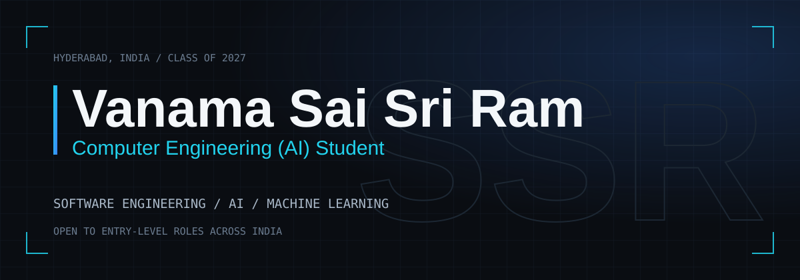

 

Final-year Computer Engineering (AI) student who enjoys building practical software and AI-powered solutions. 
Open to entry-level Software Engineering and AI/ML opportunities across India.

 

[**Portfolio**](https://saisriramvanama.vercel.app/) &nbsp;·&nbsp; [**LinkedIn**](https://www.linkedin.com/in/saisriramv/) &nbsp;·&nbsp; [**GitHub Projects**](https://github.com/SaiSriRam-Vanama?tab=repositories) &nbsp;·&nbsp; [**Contact**](mailto:saisriram2796@gmail.com)

## 01 · About

I'm Vanama Sai Sri Ram, a final-year B.Tech student in Computer Engineering (Artificial Intelligence) at Marwadi University. I like taking an idea all the way to a working application, and I'm most interested in software engineering and AI/ML.

My projects so far include a microservices-based parking platform, a startup-risk analysis system built with scikit-learn, and a career-planning assistant. I've also completed internships in full-stack development and data analytics. I'm looking for an entry-level role where I can keep building, learn from experienced engineers, and solve practical problems.

## 02 · Education

**B.Tech, Computer Engineering (Artificial Intelligence)**  
Marwadi University · Graduation: 2027 · CGPA: **7.96 / 10**

**Diploma, Computer Science Engineering**  
Sree Dattha Group of Institutions · 2021 – 2024 · CGPA: 8.72 / 10

## 03 · Technical Skills

Grouped by area, not by proficiency. Everything listed is something I've used in projects, internships or coursework.

**Programming Languages**  
`Python` `JavaScript` `TypeScript` `SQL`

**AI / Machine Learning**  
`scikit-learn` `pandas` `LSTM` `Model Evaluation` `Explainable AI (SHAP)`

**Frontend**  
`HTML` `CSS` `React` `Next.js`

**Backend**  
`Flask` `FastAPI` `Node.js` `Express` `REST APIs`

**Databases**  
`MySQL` `MongoDB` `Firebase`

**Tools and Platforms**  
`Git` `GitHub` `Docker` `AWS` `VS Code`

## 04 · Selected Projects

### ParkIQ
*A microservices-based parking management platform.*

Handles user authentication, parking slot management, booking, pricing and payments through an API gateway and dedicated services, with a React frontend.

`Node.js` `Express` `MongoDB` `React` `Vite` `Socket.IO` `Stripe` `Docker`

[Live Demo](https://smart-park-iq.vercel.app) · [GitHub Repository](https://github.com/SaiSriRam-Vanama/Park-IQ)

### PulselensAI
*Early failure detection for online startups.*

Combines website, hiring and social-media signals in a hybrid scoring engine that produces a health score, a risk level and a breakdown of the signals behind it.

`Python` `Flask` `scikit-learn` `pandas` `BeautifulSoup`

[Live Demo](https://pulselensai.onrender.com/) · [GitHub Repository](https://github.com/SaiSriRam-Vanama/PulselensAi)

### AI Career Autopilot
*A resume-driven career planning assistant.*

Extracts skills from an uploaded resume, compares them with job-market data, and generates a 12-week learning roadmap. Also includes a job application tracker and an AI advisor chat.

`Next.js` `FastAPI` `MongoDB` `Hugging Face` `Groq`

[Live Demo](https://ai-career-autopilot.vercel.app) · [GitHub Repository](https://github.com/SaiSriRam-Vanama/ai-career-autopilot)

## 05 · Experience and Achievements

### Professional Internships
- **Code Alpha** · Full Stack Engineer Intern
- **CHEARS** · Data Analytics Intern

### Virtual Job Simulations
Completed online. These are not employment.

- **Deloitte** · Data Analytics Job Simulation · Oct 2025
- **Tata Group** · GenAI-Powered Data Analytics · Oct 2025
- **Deloitte** · Technology Job Simulation · Oct 2025
- **Deloitte** · Cyber Job Simulation · Jun 2025

### Certifications
- **AWS** · Foundations of Prompt Engineering
- **AWS** · Introduction to Machine Learning
- **Oracle** · Database with SQL
- **Cisco** · Python Essentials
- **Cisco** · Operating Systems

### Learning Programs
- **Google for Developers** · Build with AI Bootcamp · Sep 2026
- **Nestlé** · E-learning 2026: Resilience

### Hackathons and Events
- HackTheMountain
- Intellify 3.0
- Frontend Battle, IIT Bhubaneswar

### Patent
**Thermal Management System for IT Infrastructure**  
Application No. 202521090573 · Filed 22 September 2025 · Published 3 October 2025

## 06 · GitHub Activity

  
  

These cards show GitHub activity only. They are not a measure of skill or experience.

## 07 · Contact

I'm open to entry-level Software Engineering and AI/ML opportunities across India.

**Portfolio** · [saisriramvanama.vercel.app](https://saisriramvanama.vercel.app/)  
**LinkedIn** · [linkedin.com/in/saisriramv](https://www.linkedin.com/in/saisriramv/)  
**GitHub** · [github.com/SaiSriRam-Vanama](https://github.com/SaiSriRam-Vanama)  
**Email** · [saisriram2796@gmail.com](mailto:saisriram2796@gmail.com)
